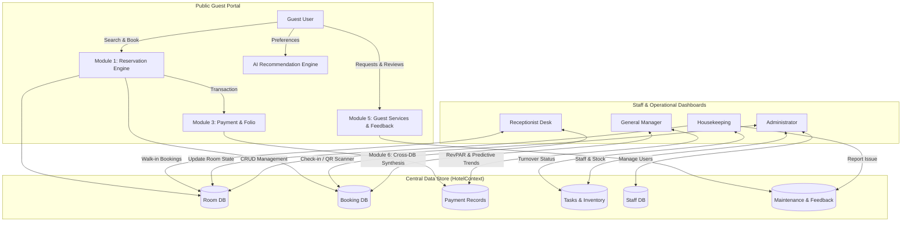

# LUMORA — Smart Hotel Management System (SHMS)

<div align="center">


### *Stay Beautifully. Manage Intelligently.*

A modern, full-featured luxury hospitality and intelligent hotel management platform.  
Engineered with **React 19**, **TypeScript**, **Vite**, **Recharts**, and a bespoke luxury design system.

[](https://react.dev/)
[](https://www.typescriptlang.org/)
[](https://vitejs.dev/)
[](LICENSE)

[Key Features](#-key-features) • [User Roles & Demos](#-user-roles--demo-personas) • [Architecture](#-system-architecture--dfd-alignment) • [Getting Started](#-getting-started) • [Tech Stack](#-technology-stack) • [Project Structure](#-project-structure)

</div>

---

## 🌟 Overview

**LUMORA** is a next-generation Smart Hotel Management System (SHMS) that bridges the gap between high-end guest experiences and high-efficiency hotel operations. From effortless room discovery, algorithmic AI room recommendations, and digital QR contactless check-in to real-time housekeeping turnover boards and executive predictive analytics, LUMORA delivers an end-to-end hospitality operating system.

The system is architected around **6 core operational modules** aligned with real-world software engineering Data Flow Diagrams (DFDs), backed by local client-side persistence and zero-friction role switching.

---

## ✨ Key Features

### 🛎️ 1. Guest Experience & Public Portal
* **Curated Room Showcase**: Explore accommodations categorized from *Standard* and *Deluxe* to *Executive*, *Terrace Suites*, and the *Presidential Penthouse* with high-resolution imagery, verified reviews, capacity badges, and full amenity breakdowns.
* **AI Recommendation Engine (`/ai-recommendations`)**: Algorithmic room matching based on travel intent (*Relaxation*, *Business*, *Romance*, *Family*), budget tiers, party size, and lifestyle amenities (e.g., Rainforest shower, soaking tub, 24/7 butler).
* **Frictionless Booking & Checkout (`/booking/checkout`)**: Multi-step checkout with live night calculations, real-time room tax and fee breakdowns, payment method selection (Card, Apple Pay, Pay at Desk), and interactive celebratory confetti.
* **Digital QR Keyless Pass (`/qr-pass/:id`)**: Mobile-ready digital pass featuring a live-pulsing QR code for express check-in, dynamic Wi-Fi access tokens, NFC door unlock simulator, and arrival countdowns.
* **In-Stay Guest Services (`/services`)**: On-demand ordering for artisanal room service dining, extra linen/turndown, concierge transfer requests, and technical suite maintenance tickets.
* **Guest Feedback & Sentiment Engine**: Built-in star ratings, category tagging (*Cleanliness*, *Dining*, *Amenities*, *Staff*), and sentiment tracking.

### 👔 2. Administrator Dashboard (`/dashboard/admin`)
* **Global Executive Overview**: Live KPI counters for total rooms, occupancy rates, active bookings, checked-in guests, pending turnovers, and gross revenue.
* **Complete Room Inventory CRUD**: Add, edit, adjust pricing, floor assignments, bed types, and status (*Available*, *Occupied*, *Cleaning*, *Maintenance*).
* **Booking Ledger & Overrides**: Search, filter, inspect details, and cancel or override reservation statuses in real time.
* **Staff Directory**: Add new staff, track shift assignments (*Morning*, *Evening*, *Night*), and monitor duty status.
* **Supply Inventory Monitoring**: Track critical hospitality supplies (linens, luxury toiletries, craft beverages, cleaning supplies) with automatic low-stock warning thresholds.

### 🔑 3. Receptionist Desk (`/dashboard/receptionist`)
* **Arrivals & Departures Stream**: Real-time list of guests arriving today and departures pending checkout.
* **QR Digital Pass Scanner**: Interactive scanner simulator to verify guest passes (`LUM-PASS-xxxxxx`), validate booking details, and complete 1-click check-ins.
* **Walk-In Booking Desk**: Rapid reservation form allowing front desk agents to assign available rooms to walk-in guests on the fly.
* **Folio & Guest Invoicing**: Integrated digital guest folios with line-item charge breakdowns and print-ready formatting.

### 🧹 4. Housekeeping Board (`/dashboard/housekeeping`)
* **Room Turnover Pipeline**: Visual task cards prioritized by urgency (*Urgent Turnover*, *High*, *Medium*, *Normal*).
* **Real-Time Status Flow**: Transition tasks from `Pending` → `In Progress` → `Completed` or mark as `Blocked (DND)`.
* **Auto-Synchronization**: Marking a turnover as `Completed` automatically updates the room’s state in the master room database to `Available`.
* **Direct Maintenance Logging**: Housekeeping staff can report room defects (plumbing, lighting, climate control) directly to facilities engineering.

### 📊 5. General Manager Analytics (`/dashboard/manager`)
* **Interactive Financial Analytics**: Powered by **Recharts** with time-range filtering (7 Days, 30 Days, Quarter).
* **Predictive Revenue & Occupancy Forecasts**: Visual comparison of actual historical performance against algorithmic forward forecasts.
* **Hospitality Industry Metrics**:
  * **ADR** (Average Daily Rate)
  * **RevPAR** (Revenue Per Available Room)
  * **Occupancy Rate Percentage**
  * **Customer Satisfaction Index** (CSAT)
* **Category Contribution**: Distribution breakdown of revenue by room type (Presidential, Suites, Executive, Deluxe).
* **Staff Performance Metrics**: Real-time scores and completed turnover volumes per team member.

---

## 👥 User Roles & Demo Personas

LUMORA comes with a floating **Staff Role Switcher (DemoBar)** on every screen, allowing immediate testing of any user role without needing to re-login:

| Role | Demo User | Email | Key Capabilities |
| :--- | :--- | :--- | :--- |
| **Guest** | Eleanor Vance | `eleanor.vance@example.com` | Room exploration, AI recommendation, online checkout, digital QR pass, services ordering |
| **Administrator** | Alexander Sterling | `alexander.s@lumorahotels.com` | Room CRUD, staff assignments, inventory thresholds, reservation oversight |
| **Receptionist** | Mia Chen | `mia.chen@lumorahotels.com` | Express arrivals/departures, QR pass scanner, walk-in creation, folio printing |
| **Housekeeping** | Elena Rostova | `elena.r@lumorahotels.com` | Room turnover taskboard, priority management, facility fault reporting |
| **General Manager** | Victoria Kensington | `v.kensington@lumorahotels.com` | Predictive trend forecasting, RevPAR/ADR charts, revenue share, department KPIs |

---

## 🏗️ System Architecture & DFD Alignment

The application is structured following modular Software Engineering Data Flow Diagram (DFD) entities:



### Module Mapping
* **Module 1 (Guest Reservation & Booking)**: Handles search parameters, multi-guest calculations, date validation, and reservation confirmation.
* **Module 2 (Room Inventory & Availability Control)**: Controls real-time room availability, floor assignments, and occupancy states.
* **Module 3 (Payment Gateway & Folio Records)**: Simulates authorization gateways, generates transaction references (`TXN-LUM-xxxx`), and maintains printable guest folios.
* **Module 4 (Task & Maintenance Management)**: Coordinates room cleaning workflows, low-stock threshold triggers, and facility repairs.
* **Module 5 (Guest Services & Experience Management)**: Manages in-suite dining requests, amenities delivery, and guest sentiment capture.
* **Module 6 (Executive Analytics & Data Synthesis)**: Aggregates multi-database statistics into RevPAR, ADR, and forward forecasting metrics.

---

## 🎨 Design System & Luxury Aesthetics

LUMORA uses a dedicated, modern luxury design system implemented in clean CSS variables with zero bloated CSS frameworks:

| Token | Hex / Value | Description |
| :--- | :--- | :--- |
| `--color-midnight` | `#0B1957` | Deep navy primary brand anchor for typography and dark surfaces |
| `--color-sapphire` | `#426BC2` | Royal sapphire accent for primary CTAs, links, and active states |
| `--color-petal` | `#E8D9ED` | Soft lilac tone for subtle containers, badges, and accents |
| `--color-lace` | `#F7F4ED` | Warm ivory background delivering a refined editorial feel |
| `--color-lavender` | `#D2B3DB` | Delicate highlight color for secondary accents and cards |
| `--color-bridal-blue` | `#E9F3FF` | High-clarity light blue used for stat card containers and notifications |

* **Typography**: Clean pairings of **Outfit** (headings, numerical metrics, hero statements) and **Plus Jakarta Sans** (interface text, forms, tables).
* **Responsive Layout**: Fluid desktop grid collapsing into an app-like bottom navigation bar on mobile viewports.

---

## 💻 Technology Stack

* **Core Framework**: [React 19](https://react.dev/) (`19.2.8`)
* **Language**: [TypeScript 6](https://www.typescriptlang.org/) (`~6.0.2`)
* **Build System**: [Vite 8](https://vitejs.dev/) with Rolldown compiler integration
* **Routing**: [React Router v7](https://reactrouter.com/) (`7.18.4`)
* **Visualizations & Charts**: [Recharts](https://recharts.org/) (`3.10.1`)
* **Iconography**: [Lucide React](https://lucide.dev/) (`1.55.0`)
* **Interactive Effects**: [Canvas Confetti](https://www.npmjs.com/package/canvas-confetti)
* **Code Linting**: [Oxlint](https://oxc.rs/docs/guide/usage/linter.html) (`1.81.0`)
* **State & Persistence**: React Context API (`AuthContext`, `HotelContext`, `NotificationContext`) with automatic `localStorage` serialization and fault-tolerant parsing.

---

## 📁 Project Structure

```text
SHMS/
├── index.html                   # HTML entry point with fonts & metadata
├── package.json                 # Dependencies and npm scripts
├── tsconfig.json                # TypeScript root configuration
├── tsconfig.app.json            # Client compilation settings
├── vite.config.ts               # Vite bundler configuration
├── .oxlintrc.json               # Oxlint high-speed linter rules
│
├── public/                      # Static assets & icons
│   ├── favicon.svg              # App favicon
│   └── icons.svg                # Vector icons
│
└── src/
    ├── main.tsx                 # React DOM mount point
    ├── App.tsx                  # Top-level routing & layout orchestration
    ├── App.css                  # Global layout styles & animations
    ├── index.css                # LUMORA Design System tokens & base CSS
    │
    ├── assets/                  # Local media assets
    │   └── hero.png             # Hero banner imagery
    │
    ├── types/                   # Unified TypeScript interfaces & types
    │   └── index.ts             # Room, Booking, Staff, Payment, Task interfaces
    │
    ├── context/                 # Context providers (State layer)
    │   ├── AuthContext.tsx      # User authentication, roles, session state
    │   ├── HotelContext.tsx     # Centralized multi-database operations
    │   └── NotificationContext.tsx # Global toast notification manager
    │
    ├── data/                    # Initial seed datasets & mock databases
    │   ├── initialRooms.ts      # Room catalog (Standard to Presidential)
    │   ├── initialBookings.ts   # Active and historical guest reservations
    │   ├── initialStaff.ts      # Staff directory with shifts and roles
    │   ├── initialTasks.ts      # Housekeeping turnover task records
    │   ├── initialInventory.ts  # Hospitality supplies & stock thresholds
    │   ├── initialPayments.ts   # Transaction records & gateway responses
    │   ├── initialServices.ts   # In-room dining and guest service orders
    │   ├── initialFeedback.ts   # Guest review logs & sentiment records
    │   └── initialMaintenance.ts# Facility engineering fault tickets
    │
    ├── components/
    │   ├── cards/
    │   │   ├── RoomCard.tsx     # Reusable luxury room display card
    │   │   └── StatCard.tsx     # KPI metric display widget
    │   ├── common/
    │   │   ├── Header.tsx       # Navigation bar with role indicators
    │   │   ├── Footer.tsx       # Brand footer with links and hours
    │   │   ├── Logo.tsx         # Stylized folded 'L' SVG brand identity
    │   │   ├── DemoBar.tsx      # Floating staff role switcher
    │   │   ├── MobileBottomBar.tsx # Mobile dock navigation
    │   │   └── ErrorBoundary.tsx# Crash protection wrapper
    │   └── layout/
    │       ├── PublicLayout.tsx # Container for public & guest pages
    │       └── DashboardLayout.tsx # Admin/staff sidebar and topbar frame
    │
    └── pages/
        ├── public/              # Guest-facing pages
        │   ├── HomePage.tsx               # Landing page with hero & booking widget
        │   ├── RoomsPage.tsx              # Filterable room catalog
        │   ├── RoomDetailsPage.tsx        # High-res room specs & booking trigger
        │   ├── AiRecommendationsPage.tsx  # Interactive AI room matching tool
        │   ├── CheckoutPage.tsx           # Multi-step checkout & payment
        │   ├── BookingConfirmationPage.tsx# Post-booking celebratory screen
        │   ├── QrPassPage.tsx             # Keyless digital pass & QR pass
        │   ├── MyBookingsPage.tsx         # Guest reservation management
        │   ├── GuestServicesPage.tsx      # In-room dining & service ordering
        │   ├── AboutPage.tsx              # Brand architecture & philosophy
        │   ├── ContactPage.tsx            # Concierge contact & directions
        │   ├── HelpPage.tsx               # Guest FAQs and support center
        │   ├── LoginPage.tsx              # Account login page
        │   ├── RegisterPage.tsx           # Guest account registration
        │   └── ProfilePage.tsx            # Guest profile preferences
        │
        └── dashboards/          # Operations & administrative pages
            ├── AdminDashboard.tsx         # Global management, Room CRUD, Staff
            ├── ReceptionistDashboard.tsx  # Express arrivals, QR scanner, Folios
            ├── HousekeepingDashboard.tsx  # Room turnover & maintenance tickets
            └── ManagerDashboard.tsx       # Predictive analytics & Recharts KPIs
```

---

## 🚀 Getting Started

### Prerequisites
* [Node.js](https://nodejs.org/) (version `18.0.0` or higher recommended)
* `npm` (bundled with Node.js) or `pnpm` / `yarn`

### Installation

1. **Clone the repository**:
   ```bash
   git clone https://github.com/your-username/shms.git
   cd shms
   ```

2. **Install project dependencies**:
   ```bash
   npm install
   ```

3. **Start the development server**:
   ```bash
   npm run dev
   ```

4. **Open the application**:
   Open your browser and navigate to `http://localhost:5173`.

---

## 📜 Available Scripts

In the project directory, you can run:

| Command | Description |
| :--- | :--- |
| `npm run dev` | Starts the local Vite development server with Hot Module Replacement (HMR). |
| `npm run build` | Compiles TypeScript (`tsc -b`) and generates an optimized production build in `/dist`. |
| `npm run preview` | Locally serves the production build for smoke testing. |
| `npm run lint` | Runs [Oxlint](https://oxc.rs/) for lightning-fast JavaScript/TypeScript static analysis. |

---

## 💾 Data Persistence & Reset

LUMORA uses browser `localStorage` to persist changes across browser reloads:
* Modifications to room availability, new reservations, housekeeping turnovers, inventory counts, and service requests are automatically saved under keys prefixed with `lumora_*` (e.g., `lumora_rooms`, `lumora_bookings`, `lumora_tasks`).
* **To reset the application to fresh sample data**: Simply clear your browser's local storage for `localhost` (e.g., in DevTools > Application > Storage > Clear Site Data) or invoke `localStorage.clear()` in the console.

---

## 🔒 Security & Code Quality

* **Strict TypeScript**: Configured with strict typing across all interfaces to eliminate runtime errors.
* **Component Encapsulation**: Modular architecture with reusable UI cards, form state validation, and layout wrappers.
* **Oxlint Rules**: Zero-dependency high-speed linting catching common React Hooks violations and invalid exports.

---

## 📄 License

This project is licensed under the [MIT License](LICENSE). You are free to use, modify, and distribute this software for educational and commercial purposes.

---

<div align="center">
<sub>Crafted with precision for luxury hospitality. © LUMORA Hotel Management System.</sub>
</div>
